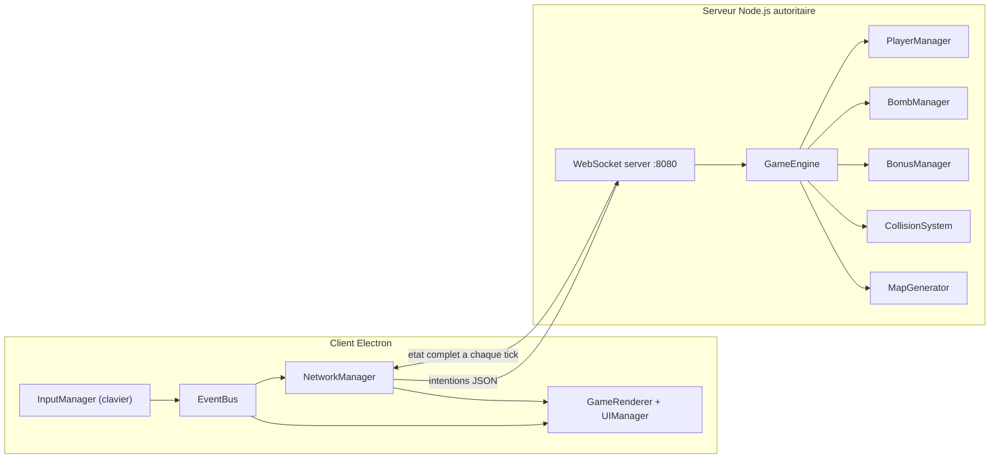
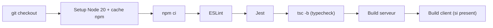

<div align="center">

# BOMBERMAN ARENA

**Un battle royale en grille. Un serveur qui ne ment jamais. Une usine logicielle au service du fun.**

*Action arcade multijoueur en temps réel · 2 à 4 joueurs · WebSocket · TypeScript*

[](https://github.com/Moreau-Simon/BOMBERMAN-ARENA/actions/workflows/ci.yml)
[](https://nodejs.org)
[](https://www.typescriptlang.org)
[](https://www.electronjs.org)
[](https://jestjs.io)

</div>

---

## Le produit

**Bomberman Arena** est un jeu d'action multijoueur qui reprend les codes légendaires du genre et les amène sur le réseau. Quatre joueurs, une grille 13×11, des caisses destructibles, des bombes à retardement de 3 secondes et des bonus qui renversent la partie. Chaque manche est un sprint tactique de survie : posez, piègez, explosez, ramassez, survivez.

Derrière ce spectacle de pixels se cache une ambition plus grande : **une production logicielle de niveau industriel**. Ce dépôt est architecturé comme un produit de studio professionnel :

- **Serveur autoritaire** : aucune décision de gameplay ne dépend du client. Le client envoie des *intentions* ; le serveur valide, calcule et tranche. La triche n'a pas de place ici.
- **Client de bureau** : [Electron](https://www.electronjs.org) + [TypeScript](https://www.typescriptlang.org), avec un rendu entièrement découplé du réseau par un [bus d'événements](packages/client/src/renderer/EventBus.ts), conformément au pattern imposé par le cahier des charges.
- **Monorepo typé de bout en bout** : un package `shared` unique définit l'état du jeu et le protocole. Client et serveur ne peuvent pas se désynchroniser : le compilateur l'interdit.

---

## Fonctionnalités

### Gameplay

- 🕹️ **Déplacement fluide sur grille** — physique continue côté serveur (delta time, hitbox 0,7 tuile, normalisation des diagonales, *corner assist* dans les couloirs). Une tuile = 48 px.
- 💣 **Bombes à retardement** — 3 000 ms, portée extensible jusqu'à +4, et jusqu'à 5 bombes actives simultanément par joueur. La bombe est rendue à son propriétaire quand elle explose.
- 🧨 **Explosions en croix** — propagation case par case, stoppée par les murs indestructibles et les caisses. Durée d'affichage de 500 ms.
- 📦 **Caisses destructibles** — densité de 85 % sur la carte, 14 % de caisses renforcées, et exactement une caisse bonus garantie par manche. Le bonus qu'elle contient revient à celui qui la détruit.
- 🎁 **12 bonus répartis en 2 univers thématiques** — bombe supplémentaire, portée, vitesse, points de vie, bonus permanents, malus temporisés (5 s). Tirage pondéré par thème, avec un bonus spécial exclusif par univers :

| Thème | Bonus standard | Bonus légendaire |
| --- | --- | --- |
| **Campagne** | Champignon, Épi de maïs, Plume, Pot de miel | **Trèfle à 4 feuilles** (+2 bombes, +2 portée) |
| **Urbain** | Batterie, Bidon d'essence, Rollers, Gilet réfléchissant | **Coffre doré** (+2 bombes, +2 portée) |

- ❤️ **Système de PV (2 max) avec invulnérabilité de 1,5 s** — un seul dégât par explosion, jamais deux. Mieux vaut un duel que deux éliminations injustes.
- 🏁 **Boucle de partie complète** — lobby (2 à 4 joueurs), compte à rebours, manche, victoire (dernier survivant), retour au lobby propre pour la suivante.
- 🎮 **Mode local hors ligne** — un moteur embarqué ([`LocalGameEngine`](packages/client/src/renderer/LocalGameEngine.ts)) fait tourner le jeu sans serveur et jusqu'à 2 joueurs sur le même clavier. Idéal pour tester l'interface avec des fausses données, sans un seul octet sur le réseau.

### Technique

- **Serveur de jeu autoritaire** — [GameEngine](packages/server/src/GameEngine.ts) à tick fixe de 50 ms, avec accumulateur de temps plafonné pour éviter la spirale de latence.
- **Protocole WebSocket typé** — messages discriminés par champ `type`, définis une seule fois dans `packages/shared`. Voir la section [Protocole WebSocket](#-protocole-websocket-json).
- **Package partagé** — `@bomberman-arena/shared` mutualise constantes, types d'état, règles de bonus et validation. Une seule source de vérité.
- **Client découplé par bus d'événements** — `InputManager` → `EventBus` → `GameRenderer` / `UIManager` : la logique réseau ne touche jamais le rendu directement.
- **CI sur chaque push et PR** — lint, tests, typecheck, build. Rouge = refusé.
- **Image Docker du serveur** — [`node:20-alpine`](packages/server/Dockerfile), port 8080, prête pour le déploiement.

---

## Architecture

### Monorepo

```text
BOMBERMAN-ARENA/
├─ packages/
│  ├─ shared/         @bomberman-arena/shared — types, constantes, protocole, validation, bonus
│  ├─ server/         @bomberman-arena/server — moteur Node.js (WebSockets, règles, Dockerfile)
│  │  └─ src/
│  │     ├─ GameEngine.ts        boucle de jeu à tick fixe (chef d'orchestre)
│  │     ├─ PlayerManager.ts     joueurs, PV, entrées, prêts, éliminations
│  │     ├─ BombManager.ts       bombes, explosions, dégâts
│  │     ├─ BonusManager.ts      application et expiration des bonus
│  │     ├─ CollisionSystem.ts   résolution des déplacements sur la grille
│  │     ├─ MapGenerator.ts      génération de carte par manche (thèmes, caisses)
│  │     └─ __tests__/           tests unitaires (Jest) de tout le moteur
│  └─ client/         @bomberman-arena/client — client de bureau Electron
│     └─ src/
│        ├─ main.ts              process principal Electron
│        └─ renderer/
│           ├─ GameRenderer.ts   rendu du monde
│           ├─ InputManager.ts   clavier → intentions
│           ├─ NetworkManager.ts WebSocket → bus d'événements
│           ├─ UIManager.ts      menus, lobby, HUD, overlays
│           ├─ LocalGameEngine.ts simulation hors ligne (mock réseau)
│           └─ EventBus.ts       couplage faible entre toutes les briques
├─ assets/            sprites, tuiles, cartes, bonus (thèmes Campagne et Urbain)
├─ models/            animations et modèles côté rendu
└─ .github/workflows/ pipeline d'intégration continue (GitHub Actions)
```

### Flux Client ↔ Serveur



**Principe fondateur** : à chaque tick de 50 ms, le serveur avance la simulation (physique, mèches des bombes, explosions, bonus, conditions de fin), puis diffuse un état complet `SERVER_STATE_UPDATE` à tous les clients. Le client n'interprète et n'affiche jamais une vérité venue d'ailleurs. La synchronisation est fiable parce qu'elle est centralisée.

---

## Protocole WebSocket JSON

Chaque message est un objet JSON avec un discriminant `type` ([définition](packages/shared/src/protocol.ts)).

| Sens | Message | Payload | Description |
| --- | --- | --- | --- |
| Client → Serveur | `CLIENT_JOIN` | `{ playerName, isHost? }` | Rejoindre le lobby, annoncer son pseudo |
| Client → Serveur | `CLIENT_READY` | — | Signaler que le joueur est prêt à jouer |
| Client → Serveur | `CLIENT_INPUT` | `{ direction, state }` | Appui/relâchement de touche (intention de déplacement) |
| Client → Serveur | `CLIENT_PLACE_BOMB` | — | Intention de poser une bombe |
| Serveur → Client | `SERVER_WELCOME` | `{ playerId, playerName }` | Connexion acceptée, identité assignée |
| Serveur → Client | `SERVER_PLAYER_JOINED` | `{ playerId, playerName }` | Un joueur est entré dans le lobby |
| Serveur → Client | `SERVER_GAME_START` | `{ theme }` | La manche débute |
| Serveur → Client | `SERVER_STATE_UPDATE` | `GameState` | Snapshot complet de la manche, diffusé à chaque tick |
| Serveur → Client | `SERVER_ERROR` | `{ message }` | Erreur traitée proprement plutôt que subie |

Exemple de snapshot `SERVER_STATE_UPDATE` ([type complet](packages/shared/src/types.ts)) :

```json
{
  "type": "SERVER_STATE_UPDATE",
  "payload": {
    "map": [[0, 2, 1, 2]],
    "players": [
      {
        "id": "uuid-1234",
        "name": "PLAYER1",
        "position": { "x": 0.5, "y": 0.5 },
        "direction": "DOWN",
        "isAlive": true,
        "hp": 2,
        "maxBombs": 2,
        "effects": ["ROLLERS"]
      }
    ],
    "bombs": [{ "id": "bomb-1", "position": { "x": 1, "y": 0 }, "range": 3 }],
    "explosions": [],
    "crates": [{ "x": 3, "y": 1, "hp": 1, "bonusId": "MIEL" }],
    "phase": "PLAYING",
    "tick": 1204,
    "theme": "URBAN"
  }
}
```

---

## Démarrage rapide

### Prérequis

- **Node.js 20.x** et npm
- Une connexion réseau pour le multijoueur (et pas besoin d'un serveur pour le mode local)

### Installation

```bash
# 1. Cloner le dépôt (branche main, accessible par un canal sécurisé)
git clone -b develop https://github.com/Moreau-Simon/BOMBERMAN-ARENA.git
cd BOMBERMAN-ARENA

# 2. Installer tous les workspaces en une seule passe
npm install
```

### Lancer le serveur

```bash
npm run start:server        # production (ts-node) — écoute sur :8080 en WebSocket
npm run dev:server          # développement avec rechargement à chaud (ts-node-dev)
```

### Lancer le client

```bash
npm run start:client        # ouvre la fenêtre de bureau Electron
```

Dans le client, connectez-vous à l'adresse du serveur ou choisissez le **mode local** pour jouer sans serveur. 2 à 4 joueurs peuvent rejoindre le même lobby ; le premier arrivé devient hôte.

### Serveur avec Docker

```bash
docker build -t bomberman-arena-server packages/server
docker run --rm -p 8080:8080 bomberman-arena-server
```

---

## Scripts de développement

| Commande | Effet |
| --- | --- |
| `npm run start:server` | Démarre le serveur de jeu |
| `npm run dev:server` | Serveur avec rechargement à chaud |
| `npm run start:client` | Lance le client de bureau |
| `npm run test` | Tous les tests (Jest) |
| `npm run test:server` | Tests unitaires du serveur uniquement |
| `npm run lint` | Analyse statique (ESLint + typescript-eslint) |
| `npm run format` | Formatage automatique (Prettier) |
| `npm run typecheck` | Vérification des types des 3 workspaces (`tsc -b`) |
| `npm run clean` | Nettoie les artefacts de build |

---

## Qualité et tests

Un projet de jeux vidéo se juge aussi à ce qui n'explose pas… sauf quand c'est prévu.

### Tests unitaires ([packages/server/src/\_\_tests\_\_](packages/server/src/__tests__))

- [`GameEngine.test.ts`](packages/server/src/__tests__/GameEngine.test.ts) — boucle, phases, fin de manche
- [`PlayerManager.test.ts`](packages/server/src/__tests__/PlayerManager.test.ts) — entrées, PV, invulnérabilité, prêts
- [`BombManager.test.ts`](packages/server/src/__tests__/BombManager.test.ts) — timers, propagation, restitution
- [`BonusManager.test.ts`](packages/server/src/__tests__/BonusManager.test.ts) — application, effets, expirations
- [`CollisionSystem.test.ts`](packages/server/src/__tests__/CollisionSystem.test.ts) — murs, couloirs, corner assist
- [`MapGenerator.test.ts`](packages/server/src/__tests__/MapGenerator.test.ts) — carte valide, thèmes, caisses

### Tests d'intégration

Scénarios visés : un client envoie `CLIENT_INPUT`, le serveur applique le mouvement et confirme dans le prochain `SERVER_STATE_UPDATE`. Le protocole et la validation partagée sont en place pour les accueillir, conformément aux exigences du module.

### Usine logicielle (CI/CD)

Le pipeline [`.github/workflows/ci.yml`](.github/workflows/ci.yml) se déclenche à chaque push et chaque pull request sur `main` et `develop` :



**Une étape décide de tout : en rouge, le push est refusé.** Le code qui entre dans `develop` a passé le même filtre que celui qui partira dans la release `v1.0.0`.

### Standards

- **TypeScript `strict`** activé partout, cible ES2022
- **ESLint** + **Prettier** en analyse statique et formatage
- **JSDoc** à chaque module, classe et méthode publique
- Configuration d'analyse complémentaire dans [`.embold`](.embold)

---

## Workflow de développement (GitFlow)

Le dépôt applique le GitFlow de bout en bout. La discipline n'est pas une option, elle est inscrite dans les règles du projet.

| Branche | Rôle |
| --- | --- |
| `main` | Versions stables, tags de release (`v1.0.0`) |
| `develop` | État d'intégration courant |
| `feature/*` | Une tâche = une branche = une pull request |
| `release/*` | Stabilisation avant mise en production |

Les règles :

- 🚫 **Aucun push direct** sur `main` ou `develop` (protection de branche).
- 🔍 **Toute modification passe par une Pull Request** avec revue de code.
- 👥 **Double approbation obligatoire**, dont au moins un pair du pôle Qualité/DevOps.
- 📨 **Intégrations petites et fréquentes**, jamais de gros lots en fin de sprint.

---

## Feuille de route (jalons — 32 h)

| Jalon | Période | Objectif | Statut |
| --- | --- | --- | --- |
| **Phase 1 — Initialisation** | 0 h – 8 h | Repo, GitFlow, CI « Hello World », protocole WebSocket, squelettes | ✅ |
| **Phase 2 — Core Gameplay** | 8 h – 22 h | Déplacement synchronisé, bombes, grille, tests moteur | ✅ |
| **Phase 3 — Finalisation** | 22 h – 28 h | Explosions, murs, bonus, lobby/UI, montée en couverture | 🚧 |
| **Phase 4 — Release & Revue** | 28 h – 32 h | Code freeze, refactoring final, tag `v1.0.0` | ⏳ |

---

## Organisation

Le projet se gère comme une **simulation d'entreprise**, structurée en pôles techniques distincts :

- **Pôle Backend / Serveur** — moteur de jeu asynchrone, WebSockets, synchronisation d'état, règles (collisions, explosions, victoire).
- **Pôle Frontend / Client** — rendu, entrées, interprétation du protocole, et une interface complète : menus, lobby, HUD, mode local mocké.
- **Pôle DevOps & Qualité** — GitFlow, CI/CD, lint, analyse statique, scénarios de tests, packaging (exécutables client, image Docker du serveur).

---

## Documentation

| Référence | Contenu |
| --- | --- |
| [`protocol.ts`](packages/shared/src/protocol.ts) | Spécification complète du protocole WebSocket |
| [`types.ts`](packages/shared/src/types.ts) | Modèle d'état du jeu partagé client/serveur |
| [`constants.ts`](packages/shared/src/constants.ts) | Constantes d'équilibrage (physique, timers, bonus, grille) |
| [`bonuses.ts`](packages/shared/src/bonuses.ts) | Catalogue des 12 bonus et pools de tirage |
| [`Dockerfile`](packages/server/Dockerfile) | Image Docker du serveur |
| [`ci.yml`](.github/workflows/ci.yml) | Pipeline CI complet |

À venir : la documentation technique (`docs/`) détaillera l'architecture, les diagrammes, les captures d'écran des fonctionnalités implémentées et la section « Bilan qualitatif » (post-mortem) exigée par le cahier des charges.

---

<div align="center">

**BOMBERMAN ARENA** — dépôt [Moreau-Simon/BOMBERMAN-ARENA](https://github.com/Moreau-Simon/BOMBERMAN-ARENA)

*Fabriqué avec* TypeScript · Node.js · Electron · WebSockets · Jest · Docker · GitHub Actions

*Développé par* Dorian DECITRE · Léo CORDELETTE · Manon MACK · Clément MAGNIER · Noa AUDEGOND · William MAK · Simon MOREAU

Licence : ISC

</div>